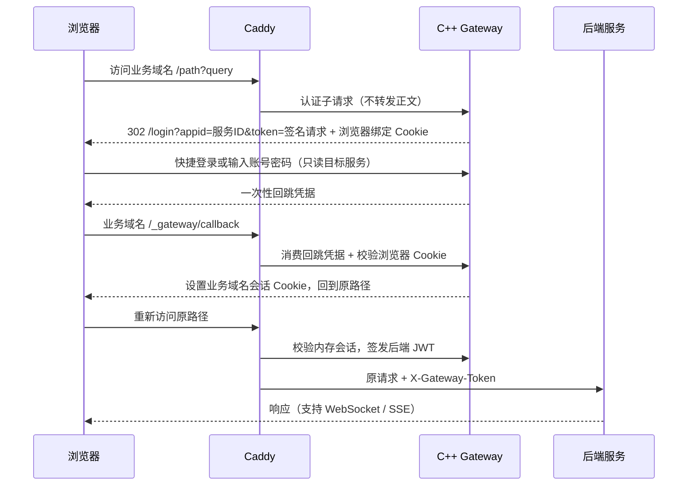

# Gateway

SDK 推荐使用 `checkCookie(request, appid, secret, 是否302, 是否允许在线回退)`，Python 包名为 `gateway_sdk`，C++ 命名空间为 `gateway::sdk`，静态库为 `libgateway_sdk.a`。返回结构中的 `result` 只有 `Ok` 和 `redictionToLogin`，原因放 `error`，失败登录地址放 `redictUrl`。完整用法见 [SDK 文档](../gateway-sdk/README.md)。

SDK 登录请求通过 `/login?appid=...&token=...` 携带签名保护的 AppID、返回地址、时间戳、有效期和版本能力；网关协商后进入统一登录页，页面上的目标服务无法修改。`POST /login` 提供无需浏览器跳转的 App 登录，参数为 `appid`、`username`、`password_envelope`、`token`，成功返回 `{"result":"Ok","retmsg":"登录成功","cookie":"..."}`，失败返回 `Failed`、原因和空 Cookie。密码通过 Gateway 公钥加密的 JWE 传输，不能再传明文 `passwd`。Token 可由 SDK 的 `createLoginToken(appid, secret, uri)` 生成，成功消费一次；完整接口说明见 SDK 文档。

C++17 + 搜狗 Workflow 的认证网关，前端是原生 HTML / CSS / JavaScript。无 Node、Python、Java 或 Go 应用运行时。现有 Caddy 负责 TLS 和流式反向代理；C++ 负责每次请求的认证、路由选择和 JWT 签发。

## 地址

- `https://gateway.perfy576.com/`：公开状态展示页，不登录、不选择后端。
- `https://gateway.perfy576.com/admin`：控制台登录。管理员始终可登录，普通用户需由管理员在内置控制台业务中授权。
- `https://gateway.perfy576.com/login?appid=...&token=...`：从业务域名跳转来的统一登录页。目标服务不可修改。

初始管理员用户名为 `admin`。密码保存在服务器文件中：

```bash
sudo cat /var/lib/gateway/initial-admin.txt
```

修改密码位于控制台的「账号安全」。修改密码、停用账号、用户管理中的撤销操作及“退出所有登录”都会撤销该用户在所有接入服务上的会话；在线会话列表中的单条撤销只影响选中的会话。

## 接入服务

1. 把业务域名 DNS 的 A/AAAA 记录指向本机，确保 80/443 可达；不要保留错误的 AAAA 记录。
2. 在 `/admin` 的「域名与服务」添加名称、自定义且唯一的 AppID、业务域名和后端地址，例如 `https://app.example.com` 对应 `http://10.0.0.8:8080` 或 `https://remote.example.com:8443`。域名字段只填 `app.example.com`。AppID 为 1 至 64 位字母、数字、下划线、点或连字符，首位为字母或数字，区分大小写。
3. 根据需要填写免登录路径，每行一条，例如 `/healthz`、`/assets/*`。前者是精确匹配，后者匹配 `/assets/` 下的内容，不会匹配 `/assets-other`。可配置 `/*` 放开整个域名。编码歧义、点段和重复斜杠不能命中免登录规则。
4. 可允许所有用户登录此业务，或者限定用户列表；管理员账号同样受业务白名单限制。关闭“允许所有用户登录此业务”后，必须勾选允许访问的账号。取消授权会立即撤销该账号在这个业务的会话，其他业务不受影响。即使是免登录路径，也会经过网关，并携带签名的匿名身份。
5. 点击服务行的钥匙按钮查看 AppID 和系统生成的 Secret，把它们配置到后端。界面可更换 Secret，系统仅保留当前一个。
6. 设置该域名的 Cookie 有效期，单位为小时，可填小数，例如 `0.5` 为半小时，`1.25` 为 75 分钟；`0` 表示服务端会话不过期。默认 `12` 小时，支持范围为 0 至 876000 小时，最小精度为 1 秒。有效期从该次登录时间计算，修改配置立即影响现有业务会话。浏览器本身会限制 Cookie 持久化时间，网关最多设置 400 天并在访问时续期；长期不访问、清除浏览器 Cookie、重启网关或主动撤销仍需要重新登录。

配置保存后立即生效，无需重启 C++ 或重载 Caddy。Caddy 只为内存配置中已登记的域名按需申请证书，已停用的业务保留 HTTPS 以展示停用提示。停用、删除服务立即停止转发；已签发的证书可能仍在 Caddy 的证书缓存中，但不授予访问权。

已停用业务的 GET/HEAD 请求会跳转至网关首页，在页头显示该业务的停用信息。302 响应头包含 `X-Gateway-Redirect-Reason: service_disabled`、`X-Gateway-Service-Appid` 和 `X-Gateway-Redirect`；落地首页会核对 URL 中的原因和 AppID，在业务确实停用时显示提示并返回前两个响应头。URL 不含 Cookie、密钥或原始业务请求信息。POST/PUT 等请求返回 403 JSON，其中 `reason` 和 `redirect_url` 提供相同信息，避免自动重定向丢失正文。Nginx auth_request 模式同样返回 403，由接入端选择处理跳转。

业务列表默认将「Gateway 控制台」置顶，业务筛选也采用相同顺序。点击域名可在新窗口访问服务；点击状态开关可直接启用或停用普通业务。添加、编辑共用右侧配置页面，左侧导航保留，页面地址支持刷新和浏览器前进/后退；普通业务仍可在操作栏删除。

「Gateway 控制台」是启动时自动创建的默认业务，AppID 固定为 `gateway-console`，域名取 `GATEWAY_HOST`，配置保存在同一张业务表中。它不能删除、停用、修改标识/路由或配置免登录路径，不提供外部 SDK 签名密钥。可单独配置允许登录的用户与 Cookie 有效期；管理员为固定授权，界面和 API 均不能取消。获准登录的普通用户仅能访问自己的账号安全页，用户角色及管理 API 权限不会因控制台登录授权而提升。

当前原有 `note.perfy576.com`、`agent.perfy576.com` 的 Caddy 站点保持原状，作为保留域名不能重复接入。要让网关接管它们，需要先迁移 `/etc/caddy/Caddyfile` 中原站点的转发规则，并更新 `/etc/gateway.env` 中的 `GATEWAY_RESERVED_HOSTS`。

## 登录与会话



- 密码：OpenSSL scrypt，独立随机盐，`N=16384, r=8, p=1`。
- 密码传输：浏览器及 Flutter 使用 `RSA-OAEP-256` + `A256GCM` 的 JWE，加密账号、密码、毫秒时间戳、Gateway origin 和用途；HTTPS 仍必须保留。GET `/api/public/password-key` 返回公钥 JWK、服务端 `timestamp_ms` 和 `audience`，每次提交重新获取，不缓存时间戳。原始密码字段（包括与密文混传）返回 426。网页修改密码、管理员设置密码也使用加密信封；无密码的用户资料编辑不需信封。
- 密码防重放：验密与授权通过后，用 MySQL 条件更新 `users.last_password_verified_at_ms`，仅接受严格大于已验证值的时间戳，并检查过去 2 分钟、未来 30 秒的时间窗口。并发重复请求仅一个成功，其余返回 409；错误密码不推进时间戳。状态持久化，重启后仍拒绝旧请求。账号在多个设备或接口上并发登录时，先完成的新时间戳可能使较早请求过期，此时重新提交会获取新时间戳。
- 会话：256 位密码学随机凭据，值为 `v1.<64位hex>`，内存只记录 SHA-256 摘要；控制台及业务有效期都由域名单独设置，`GATEWAY_SESSION_SECONDS` 仅用于首次创建内置控制台时的默认值。Cookie 使用 `__Host-`、`Secure`、`HttpOnly`、`SameSite=Lax`，无共享 Domain。登录态还绑定独立的 `__Host-gateway_binding` Cookie、业务 ID 和域名。后端访问 JWT 最长 60 秒，也不会超过当前业务会话的到期时间。
- 登录请求：HS256 签名，包含 `ver=1`、`type=login_request`、`appid`、`service_id`、完整 `return_url`、`iat`、`exp`、`jti`，5 分钟过期；JWT 头包含 `gwv=1`。内存同时保存对应摘要和目标信息。浏览器请求使用服务 Secret 通过 `gateway/browser-login/v1` 派生的密钥；SDK 请求使用独立上下文 `gateway/sdk-login/v1`，防止混用。重启后浏览器流程和已签发会话失效。
- 回跳：一次性随机 ticket，30 秒过期，绑定原浏览器、服务和登录请求；消费后删除。
- 账号密码通用，登录态按业务隔离。跳转至业务登录页时，如果 Gateway 控制台已有有效登录，页面显示当前账号和「快捷登录」按钮，点击后使用当前账号登录目标业务；页面展示及提交时都会校验目标业务权限，管理员也受业务白名单限制。无权限时按钮禁用，可点击下方灰色的「切换账号」输入其他账号密码；切换账号仅用于本次业务登录，不改变 Gateway 控制台的登录账号。没有控制台登录时直接显示账号密码表单。快捷登录使用带会话 CSRF 校验的 `POST /api/login/quick`，仍经过一次性 ticket 和原浏览器绑定校验，业务 Cookie 只在目标域名回跳成功后设置。
- 「有效会话」可按业务或控制台筛选，显示所属业务、域名、在线状态、最后访问时间和剩余有效期；`expires_at=0` 表示无限。最近 60 秒内有通过认证的请求才算在线，超过 60 秒但 Cookie 未过期的仍属于有效会话。页面和用户列表以「在线 / 有效」展示数量；会话页每 10 秒自动刷新，查询列表不会把其他会话标为在线。列表中的撤销按钮只撤销该条会话，用户管理中的撤销操作仍撤销该用户的全部会话。
- 会话、浏览器登录流程、ticket 和接口 Token 已用标记都只在内存里；重启后会话与浏览器流程失效，已用标记清空。SDK 自签 Token 仍受 5 分钟有效期约束。用户、服务配置、后端签名密钥和审计记录在 MySQL 中。
- 无登录态的 GET/HEAD 重定向；POST/PUT 等请求返回 401 和 `login_url` / `X-Gateway-Login`，避免静默丢失正文。
- 控制台的「认证请求」统计本次进程运行期间的登录、业务登录回跳、代理鉴权、后端在线校验和控制台会话校验。登录跳转和回跳分别计为各自请求的结果，控制台 API 按会话校验结果计数，重启后计数清零。代理鉴权和会话校验不访问 MySQL。密码校验、管理和审计使用独立工作线程，控制请求队列有容量限制。

## 后端验证

网关转发以下请求头，外部传入的同名头会先清除：

| Header | 含义 |
| --- | --- |
| `X-Gateway-Token` | 标准 JWT HS256，后端据此验证请求和读取身份 |
| `X-Gateway-User-Id` | 用户 ID |
| `X-Gateway-User` | 用户名 |
| `X-Gateway-Role` | 角色 |
| `X-Gateway-User-Info` | JWT claims JSON 的 Base64URL 表示，仅作为便利字段 |

JWT 的示例 payload：

```json
{
  "iss": "https://gateway.perfy576.com",
  "appid": "my-app",
  "ver": 1,
  "type": "gateway_access",
  "cookie_version": 1,
  "cookie_name": "__Host-gateway_binding",
  "cookie_sha256": "<绑定 Cookie 完整值的 SHA-256 摘要>",
  "sid": "<会话凭据摘要，匿名时为空>",
  "aud": "app.example.com",
  "sub": "1",
  "iat": 1794820000,
  "nbf": 1794819998,
  "exp": 1794820060,
  "authenticated": true,
  "username": "alice",
  "display_name": "Alice",
  "role": "user",
  "request_method": "GET",
  "request_uri_sha256": "<原始路径和查询字符串的 SHA-256 十六进制摘要>"
}
```

每个服务有独立的 256 位随机密钥，控制台显示为 64 字符文本。**把这 64 字符原样作为 UTF-8 HMAC 密钥使用，不要先做 hex 解码。** 后端固定只允许 `HS256`，验证签名、精确的 issuer/audience、exp/nbf/iat；可允许 3 秒时钟偏差。还应比对 `request_method` 以及原始路径和查询字符串的 SHA-256 摘要，防止把免登录路径的 token 用到其他路径。读取经过验证的 JWT claims 作为身份，不能只信任独立的身份请求头。

免登录路径的 token 仍然有效，但 `authenticated=false`、`sub=""`，用户名、显示名称和角色也为空。业务自己的受保护接口应要求 `authenticated=true`。用户密码和网关会话 Cookie 不会传给后端；独立的 `__Host-gateway_binding` Cookie 会被转发，SDK 必须比对它与 Token 中的摘要。后端自身的普通 Cookie、Authorization、请求路径、查询和正文保留。后端 Host 设置为后端地址，业务原域名在 `X-Forwarded-Host`。

后端验证不需要回调网关。使用缓存的独立密钥进行 HMAC 验证即可；token 有效期 60 秒，在这段时间内属于可重放的 bearer 凭据。建议远程后端使用 HTTPS。轮换密钥后新请求立即使用新密钥，后端需同步更新；若还接受旧密钥，旧 token 最长剩余 60 秒有效期。HS256 采用对称密钥，因此持有某服务密钥的后端也能为该服务签名，但不能签发其他服务的 token。

独立的 Python 3 / C++ SDK 位于 [`/data/code/gateway-sdk`](/data/code/gateway-sdk/README.md)。网关内部示例为 `examples/gateway_identity.h`。每次请求校验 `X-Gateway-Token` 和完整 `Cookie` 请求头，传入原始方法和未经解码/重写的 request-target（如 `/docs?a=1`）。请求头缺失、重复或过长时应拒绝。

```cpp
GatewayVerifier verifier(secret, "https://gateway.perfy576.com", "app.example.com");
auto identity = verifier.verify(request_token, request_method, original_request_uri, cookie_header);
// 在受保护的业务接口额外要求 identity.authenticated。
```

## 构建与运行

### 版本和在线校验

当前 Token 协议 v1（JWT 头 `gwv=1`、payload `ver=1`），Cookie 协议 v1（值的 `v1.` 前缀、payload `cookie_version=1`）。版本信息也被签名和 Cookie 摘要保护。未知版本不尝试猜测算法。

SDK 默认本地校验，支持配置 `auto` 在未知版本时回退到 `POST https://gateway.perfy576.com/verify`；`online` 每次查询网关。在线接口使用控制台钥匙弹窗里的独立校验凭据鉴权，按当前服务校验 Token、绑定 Cookie、请求信息、会话及权限。签名错误不会在 auto 模式下降级联网。网络失败一律拒绝。完整参数和示例见 SDK README。当前网关只支持 v1；未来增加协议时由网关维护新版本校验，旧 SDK 可在线回退。

在线校验凭据为 `HMAC-SHA256(service_secret, "gateway/verify-api/v1")` 的十六进制值，与签名密钥独立使用，不具备签发 JWT 的能力。密钥轮换时两者同步更新。本地校验不具备实时撤销能力，剩余有效期内仍可通过；需要即时撤销时使用 online。

```bash
sudo apt-get install build-essential git pkg-config libssl-dev libmariadb-dev nlohmann-json3-dev
make -j2
make test
```

原生 GNU Make 直接调用 C/C++ 编译器和 `ar`，包括 Workflow 依赖自身，不使用构建生成器。Workflow 固定为 `v0.11.11` 对应提交，jwt-cpp 固定为 `v0.7.1` 对应提交；首次构建从 GitHub 下载到 `.deps/`，校验提交后才使用。默认生成 `build/gateway`，`make test` 生成并运行安全测试，同时编译后端校验示例。

`make clean` 清除构建产物但保留下载的源码，之后可离线重建。支持 `BUILD_DIR`、`DEPS_DIR`、`CC`、`CXX`、`CPPFLAGS`、`CFLAGS`、`CXXFLAGS`、`LDFLAGS`、`LDLIBS`。编译选项变更后先执行 `make clean`。已有相同固定提交的本地源码时，可设置 `WORKFLOW_SRC=/path/to/workflow JWT_CPP_SRC=/path/to/jwt-cpp`，无需下载。Workflow 的原生编译规则针对 Linux。

`sudo make install` 安装网关二进制，支持 `PREFIX` 和 `DESTDIR`；不会自动覆盖环境配置、部署页面或重启运行中的服务。

会话和审计接口返回 `user_agent`、`app_package`，Web 控制台及 Flutter 控制台均展示客户端信息。User-Agent 最多采集 1024 字节并修复无效 UTF-8；包名来自可选的 `X-Gateway-App-Package` 请求头，最长 255 个 ASCII 字符（字母、数字、点、下划线、短横线，首字符为字母或数字），非法值忽略。这些字段仅供审计，不用于认证或授权。会话保留登录时的客户端信息，审计记录每次操作请求的客户端信息；历史记录的客户端为空。已有数据库先由管理员执行 `migrations/004-client-info.sql` 一次，再更新程序和页面；新部署的 `schema.sql` 已包含字段。Flutter/Dart SDK 1.3.0 支持可选包名及 User-Agent 上报，旧客户端仍兼容。

运行文件：

- 程序：`/usr/local/bin/gateway`
- 页面资源：`/opt/gateway/web/`，本地静态资源，没有 CDN 运行依赖
- 环境配置：`/etc/gateway.env`，权限 0600；新部署可参考 `deploy/gateway.env.example`，不要将真实凭据加入 Git
- 初始密码：`/var/lib/gateway/initial-admin.txt`，权限 0600
- 密码解密私钥：默认 `/var/lib/gateway/password-private.pem`，首次启动生成 RSA-3072，权限 0600；可用 `GATEWAY_PASSWORD_KEY_FILE` 指定。重启复用已有私钥，禁止放入网页目录、日志或 Git；加载时拒绝符号链接及宽松权限。
- Caddy：`/etc/caddy/Caddyfile` 和 `/etc/caddy/gateway.caddy`
- 原 Caddy 配置备份：`/etc/caddy/Caddyfile.before-gateway-20261116`

```bash
sudo systemctl status gateway caddy
sudo journalctl -u gateway -f
sudo systemctl restart gateway
```

C++ 只监听 `127.0.0.1:19090`。公网不可暴露 `/internal/*`。Caddy 管理端口保持原配置，仅本机可达。配置变更通过管理 API 保存时立即更新内存；直接修改 MySQL 后需要重启网关。

数据库连接空闲超过 1 秒后，再次使用前会检查连接；连接错误按 MySQL 错误码识别，每次操作最多重连 3 次。SQL 或权限错误不重连。事务内断线或 SQL 已开始执行时直接报错，不自动重放，避免重复写入或部分提交。间隔计时使用封装的 C API `clock_gettime(CLOCK_MONOTONIC)`。配置好数据库环境变量后，可运行 `make test-db` 验证空闲超时恢复、主动断连恢复、错误码分类、事务断线和重连次数上限；测试只调整自身连接的超时时间，测试写入会随事务回滚。

该腾讯云 MySQL 实例当前 `have_ssl=DISABLED`。因此运行配置显式设置 `DB_TLS_REQUIRED=false`，数据库链路目前不加密。已为应用创建仅限 `gateway` 库的 DML 账号，应用不使用 root。启用腾讯云 SSL 后，配置 `DB_TLS_REQUIRED=true` 和 `DB_TLS_CA=/path/to/ca.pem`，会要求 TLS 并验证服务器证书；然后重启服务。

新实例先使用管理员客户端配置执行 `node tools/init-db.mjs /path/to/admin.cnf` 来创建数据库、表和专用账号。Node 仅用于初始化及测试，不参与线上运行。现有实例不要重复执行初始化以免生成无用账号；线上环境配置已经安装。

旧实例升级 AppID 字段时，由数据库管理员在 `gateway` 库执行 `migrations/002-service-appid.sql` 一次，再安装新版二进制。原服务会暂用 `app_<数据库ID>`，可在控制台编辑为自定义名称。本机实例已完成该迁移。

已有实例升级业务 Cookie 有效期时，先执行 `migrations/003-service-cookie-lifetime.sql` 一次，再安装二进制、页面和最新 `deploy/gateway.caddy`。已有服务默认保留 12 小时。Caddy 新增的会话续期响应头必须与新版本同时部署，并保持从客户端及后端转发中清除该内部头。本机数据库已完成该迁移。

## 组件与验证

`web/components.js` 提供 `<gw-select>`、`<gw-option>` 和 `<gw-checkbox>` 组件。下拉框自绘，支持键盘选择、Esc、焦点和原生 FormData；复选框/开关以可访问的表单输入承载自定义外观。弹窗和字段通过 `showModal()`、`field()` 等复用。没有原生下拉菜单。

`node tools/session-integration.mjs` 验证控制台与业务隔离、跨业务 Cookie 拒绝、用户白名单（含管理员）、授权撤销、单会话撤销、小数有效期和无限会话。默认直连本机 19090，可用 `GATEWAY_TEST_PORT` 指定独立测试网关；测试创建的业务和账号会在结束后清理。

`node tools/quick-login-integration.mjs` 验证快捷登录、权限变更、CSRF、回跳防重放、会话撤销，以及桌面/手机浏览器中的快捷登录和切换账号。支持 `GATEWAY_TEST_PORT` 指定独立测试网关，浏览器通过本地 TLS relay 访问该实例，不经过线上 Caddy；`GATEWAY_TEST_TLS_PORT` 默认 19445。测试结束会清理临时服务、用户和 TLS 文件，截图保存在 `artifacts/quick-login-*.png`。

所有 JSON 接口同时接受 `Content-Length` 和 `Transfer-Encoding: chunked` 请求，后者由 Workflow 解码后再解析 JSON，兼容 Flutter 原生控制台等分块客户端。`node tools/chunked-json-integration.mjs` 经 Caddy 验证分块登录、中文正文、管理写入及错误响应；设置 `GATEWAY_TEST_PORT` 可改为直连独立测试实例。临时业务、用户和测试自身的控制台会话会在结束后清理。

`node tools/client-info-integration.mjs` 验证控制台、浏览器、快捷登录和 App 登录的会话及审计客户端信息，也覆盖旧客户端缺省值、包名校验、UA 长度限制和失败登录记录。支持 `GATEWAY_TEST_PORT`，临时服务及测试会话会在结束后清理。

`node tools/console-integration.mjs` 验证内置控制台的删除/路由保护、管理员固定授权、普通用户授权与管理权限隔离、控制台 Cookie 续期，以及等待 61 秒后的离线但有效状态；同样支持 `GATEWAY_TEST_PORT`。临时用户在结束后删除，控制台配置恢复到测试前状态。

`node tools/disabled-service-integration.mjs` 使用临时业务验证经 Caddy 的停用跳转、原因响应头、写请求拒绝、停用域名 TLS 许可，以及首页展示信息的状态核对；检查结束后删除临时业务。

```bash
make -j2
make test
```

`tools/integration.mjs` 对实际 Caddy 和网关运行端到端测试，临时创建测试服务，检查多服务路由、独立密钥、登录、签名请求、回跳防重放、公开路径、身份头覆盖、JWT、SSE、WebSocket 和退出撤销。设置 `GATEWAY_TEST_RESTART=1` 可额外检查重启后的会话清空和 MySQL 配置保留，这会重启线上网关。最终 23 项检查已通过，临时服务和用户已清理。

`tools/app-login-integration.mjs` 验证自定义 AppID、Secret 轮换、两套 SDK 的接口登录、错误响应、一次性消费、服务隔离、权限和限流。与其他线上联调脚本顺序运行，避免测试账号的退出或限流互相干扰。

升级加密密码协议时，管理员先执行 `migrations/005-encrypted-password.sql`，再同步更新二进制、全部网页资源和 Flutter SDK 2.0.0/App。旧明文登录客户端不再兼容，现有 Cookie 验证协议不变。测试夹具中的私钥只用于测试，不能配置为运行私钥。

`DART_BIN=/path/to/dart GATEWAY_TEST_PORT=19095 node tools/encrypted-password-integration.mjs` 验证 Web Crypto、Dart JOSE 与 C++ OpenSSL 互通、并发和递增时间戳、跨接口重放、密文篡改、时间窗口、明文拒绝及加密密码修改。指定端口应是独立测试实例，脚本创建的账号、服务和会话会清理。

`tools/browser-check.mjs` 使用 Playwright 检查桌面/手机页面、管理操作和自定义控件；`tools/business-browser-check.mjs` 检查业务登录页的只读目标及真实浏览器跨域回跳。后者为虚拟测试域名启动本地 TLS relay，不改变生产 DNS。两组浏览器检查均已通过。测试需要本机初始管理员凭据副本 `.secrets/initial-admin.txt`，并会产生测试审计记录；页面截图和测试结果在 `artifacts/`。`PLAYWRIGHT_MODULE`、`CHROMIUM_PATH` 可指定测试工具路径。
